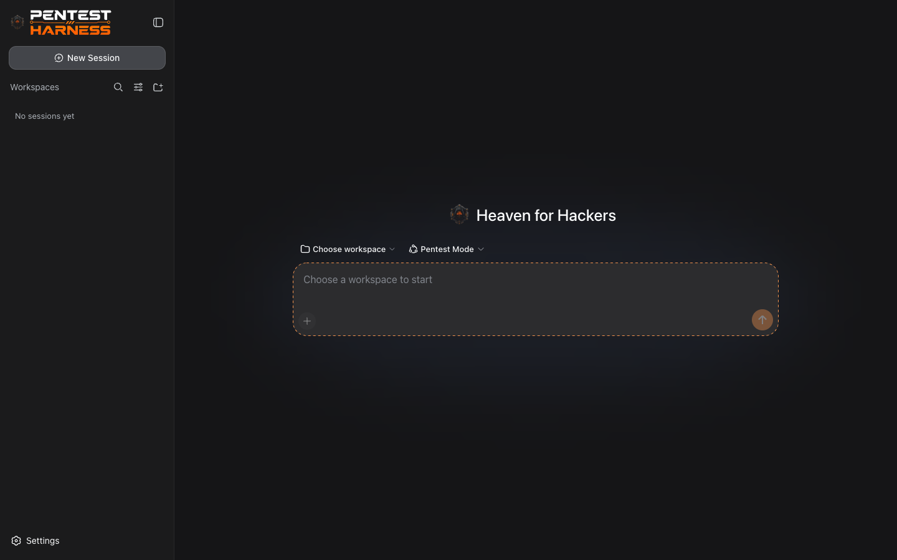
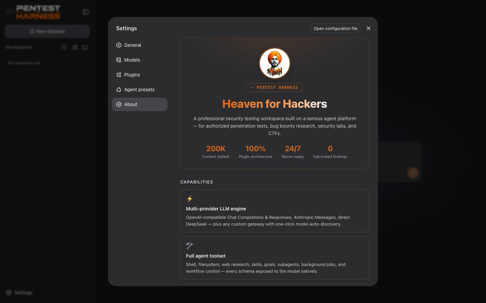
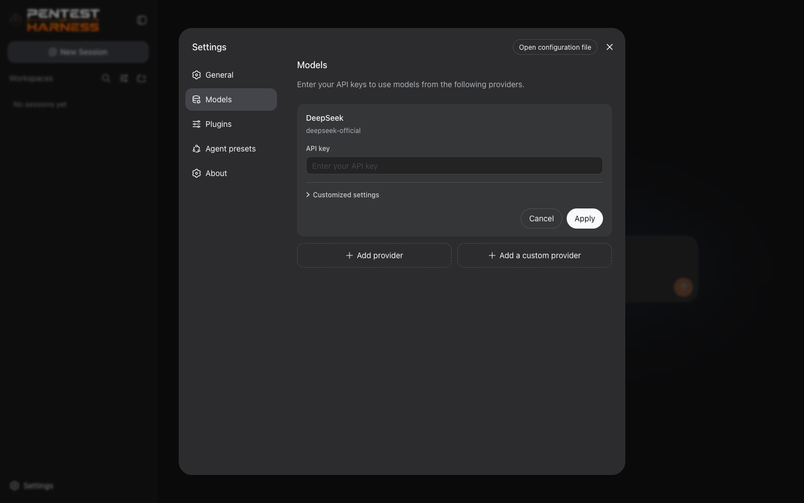

<div align="center">


# Pentest Harness

**Heaven for Hackers** — the professional security testing workspace.

A dark-first agent harness for authorized penetration tests, bug bounty research,
security labs, and CTF engagements — built on a plugin architecture where every
layer is replaceable from configuration.

</div>

---

## Screenshots

| Workspace | Settings · About | Provider cards |
|:---:|:---:|:---:|
|  |  |  |

---

## Features

- **Multi-provider LLM engine** — OpenAI-compatible Chat Completions & Responses, Anthropic Messages, and any custom gateway with one-click model auto-discovery
- **Full agent toolset** — shell, filesystem, web research, skills, goals, subagents, background jobs, and workflow control
- **Pentest Mode** — a professional offensive-security operating standard for authorized engagements
- **Provider cards** — live connection testing, enabled/disabled toggles, per-model context badges
- **Durable sessions** — JSONL/SQLite persistence with replay; resume exactly where you left off
- **Context that never dies** — token metering, automatic compaction, and tool-result pruning
- **Secure by default** — API keys live in an owner-only credential store as references; never in settings files or logs
- **Dark-only theme** — a focused, low-glare interface built for long engagements
- **Everything is a plugin** — built on Cordis; no closed core to fight

---

## Quick start

```sh
git clone https://github.com/S1N6H/pentest-harness.git
cd pentest-harness
pnpm install
pnpm build
pnpm dsh web
```

The Web UI opens at **http://127.0.0.1:2323** in your browser.

> If `pnpm dsh` is not on your PATH, use `pnpm exec dsh web` or
> `node apps/cli/lib/index.js web`.

### Requirements

- **Node.js 20+** (Node 22 recommended)
- **pnpm** (`npm i -g pnpm`)

### Run on another port

```sh
pnpm dsh web --port 3000
```

---

## First run

1. Open **Settings → Models**.
2. Click **Add a custom provider** (or **Edit** an existing one).
3. Paste your base URL — the provider ID and display name auto-fill.
4. Enter your API key (stored in your local credential store, never in settings).
5. Models auto-discover from the endpoint — click one to add it, or add by hand.
6. Pick a model in the composer and start your engagement.

---

## Defaults

| Setting | Value |
|---|---|
| Web UI | `http://127.0.0.1:2323` |
| Settings file | `$DSH_HOME/settings.yaml` (default `~/.dsh/settings.yaml`) |
| Credentials | `$DSH_HOME/.credentials.yaml` (owner-only permissions) |

---

## License

MIT
